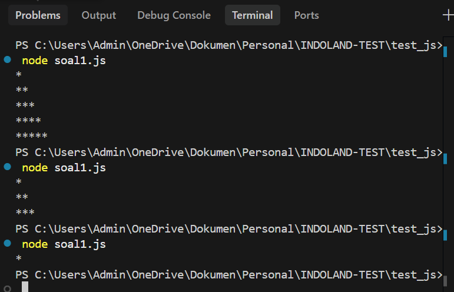
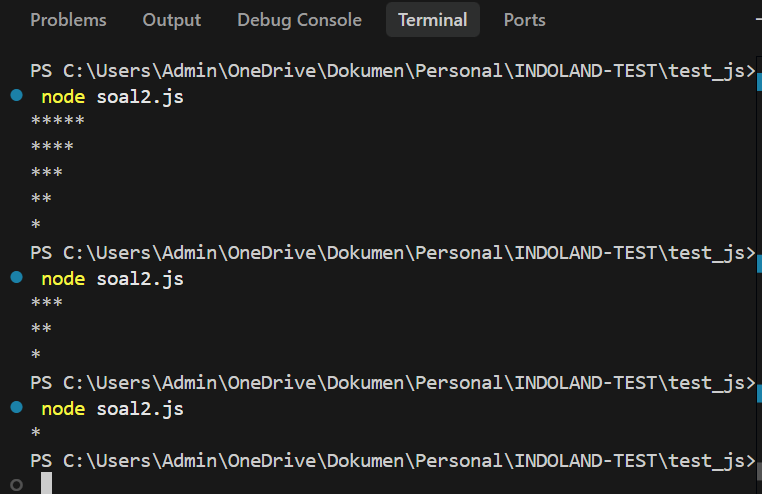
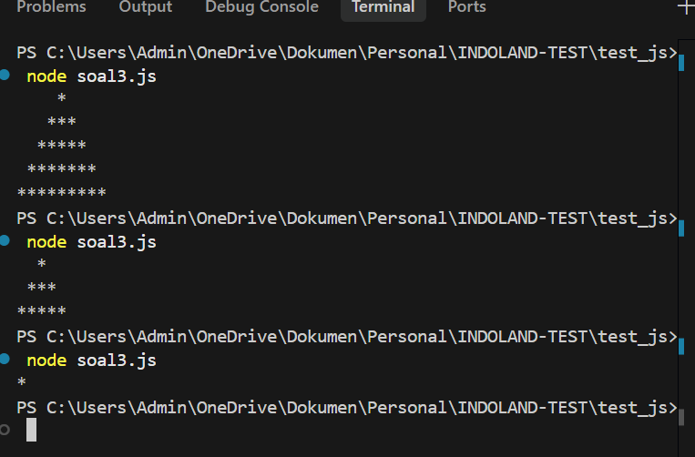
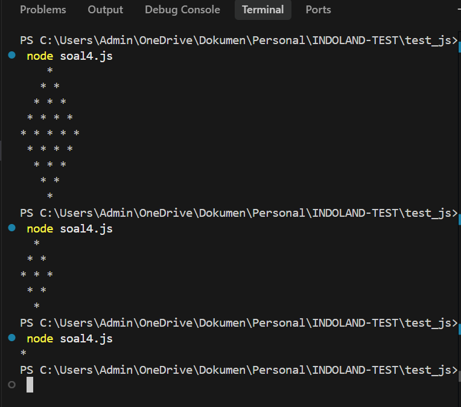
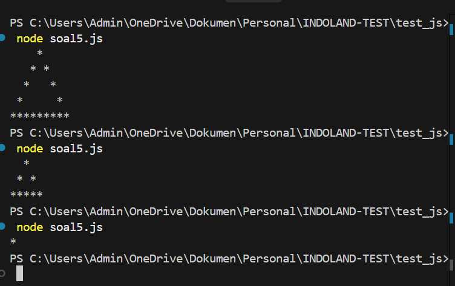

# Test JavaScript

## Struktur

```
test_js/
├── assets/        # Screenshot hasil output tiap soal
├── soal1.js
├── soal2.js
├── soal3.js
├── soal4.js
└── soal5.js
```

## Cara Menjalankan

Pastikan **Node.js** sudah terpasang, lalu jalankan dari folder `test_js`:

```bash
node soal1.js
node soal2.js
node soal3.js
node soal4.js
node soal5.js
```

> Jumlah baris dapat diubah melalui argumen pemanggilan fungsi di baris terakhir tiap file, misalnya `pattern1(5)`.

---

## Soal 1

```js
function pattern1(rows) {
    for (let a = 1; a <= rows; a++) {
        let row = "";
        for (let b = 1; b <= a; b++) {
            row += "*";
        }
        console.log(row);
    }
}
```



---

## Soal 2

```js
function pattern2(rows) {
    for (let a = rows; a >= 1; a--) {
        let row = "";
        for (let b = 1; b <= a; b++) {
            row += "*";
        }
        console.log(row);
    }
}
```



---

## Soal 3

```js
function pattern3(rows) {
  for (let a = 0; a < rows; a++) {
    let row = "";
    for (let b = 0; b < rows - a - 1; b++) row += " ";
    for (let c = 0; c < (2 * a) + 1; c++) row += "*";
    console.log(row);
  }
}
```



---

## Soal 4

```js
function pattern4(rows) {
  for (let a = 1; a <= rows; a++) {
    let row = "";
    for (let b = 1; b <= rows - a; b++) row += " ";
    for (let c = 1; c <= a; c++) row += "* ";
    console.log(row);
  }
  for (let a = rows - 1; a >= 1; a--) {
    let row = "";
    for (let b = 1; b <= rows - a; b++) row += " ";
    for (let c = 1; c <= a; c++) row += "* ";
    console.log(row);
  }
}
```



---

## Soal 5

```js
function pattern5(rows) {
    for (let a = 1; a <= rows; a++) {
        let row = "";
        let totalCols = 2 * rows - 1;
        for (let b = 1; b <= totalCols; b++) {
            let left = rows - a + 1;
            let right = rows + a - 1;
            row += (b === left || b === right || a === rows) ? "*" : " ";
        }
        console.log(row);
    }
}
```


